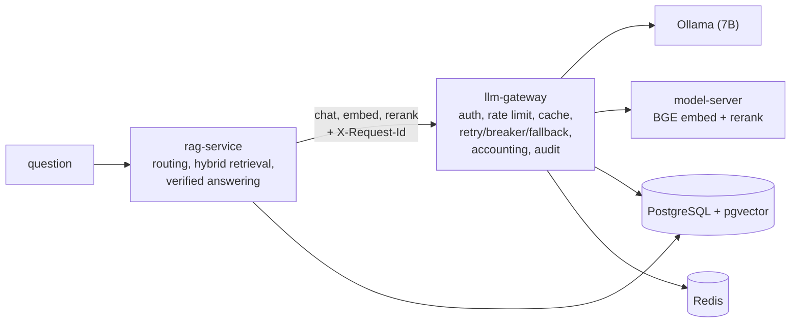

# grounded-finrag

Question answering over financial filings (10-K, 10-Q, 8-K, earnings releases) built the way an
enterprise would run it: every answer cites `[document, page]` and is verified against the
retrieved pages, numeric answers are computed in Python from cited line items, the system says
"insufficient evidence" instead of guessing, and **every model call goes through a Spring Boot
LLM gateway** with authentication, rate limiting, caching, circuit breaking, cost accounting and
an append-only audit log. Evaluated on a fixed dev/test split of the FinanceBench open-source
sample; every number below is generated from a committed results file that records the model,
hardware and commit.

**Non-commercial project.** Code: PolyForm Noncommercial 1.0.0 (`LICENSE`). Evaluation data:
FinanceBench, CC BY-NC 4.0 (`NOTICE.md`). No FinanceBench files are committed.

## Results

Models: `qwen2.5:7b-instruct-q4_K_M` (Ollama) for answers and judging, `bge-base-en-v1.5`
embeddings, `bge-reranker-base` cross-encoder (support score). Hardware: RTX 3060 Laptop GPU
(6 GB), i7-12700H. Tables below are written by `python -m finrag.eval.readme_tables`.

<!-- results:start -->

### Retrieval (evidence-page hit@k, 75 questions per split)

| Configuration | Split | hit@1 | hit@3 | hit@5 | hit@10 | MRR@10 | hit@5 95% CI | p50 ms |
|---|---|---|---|---|---|---|---|---|
| naive: fixed chunks, dense | dev | 0.12 | 0.2533 | 0.28 | 0.44 | 0.2122 | 0.1733-0.3867 | 54.05 |
| best: structure chunks, hybrid, routed | dev | 0.24 | 0.4533 | 0.6133 | 0.7067 | 0.3798 | 0.4933-0.72 | 54.26 |

Dev: commit `e599901`, NVIDIA GeForce RTX 3060 Laptop GPU, power plan Turbo, 2026-10-21. Test: not scored yet.
All 24 dev configurations: [results/retrieval/dev_ablation.md](results/retrieval/dev_ablation.md).

<!-- results:end -->

## How it works



1. **Ingestion** parses each PDF page by page, rebuilds financial tables as Markdown from word
   positions, tags chunks with company, form, fiscal period, page and section, and logs every
   parse repair ([docs/ingestion.md](docs/ingestion.md)).
2. **Retrieval** routes the question to the right company and period, fuses pgvector dense
   search and BM25 with Reciprocal Rank Fusion, and returns the top 5 chunks.
3. **Answering** asks the model for JSON claims citing source IDs (verified), or, for numeric
   questions, for cited line items plus a formula that Python evaluates. Failed checks get one
   repair, then the system abstains; a dev-tuned support threshold also triggers abstention.
4. **Evaluation**: page-level retrieval metrics for 24 configurations, an LLM judge validated
   against hand labels, citation precision, abstention curves, unanswerable probes, and naive vs
   best vs oracle comparisons. Test is scored once.

More: [architecture](docs/architecture.md) · [decision records](docs/adr/) ·
[judge rubric](docs/judge_rubric.md) · [AWS design (not deployed)](docs/aws-deployment.md) ·
[error analysis](docs/error-analysis.md)

## Quickstart

**With Docker only** (CPU embeddings; Ollama on the host with `OLLAMA_HOST=0.0.0.0`):

```bash
python scripts/download_financebench.py               # pinned commit, SHA-256 verified
ollama pull qwen2.5:7b-instruct-q4_K_M
docker compose --profile app up -d                    # PostgreSQL+pgvector, Redis, model-server, gateway, rag-service
docker compose run --rm rag-service python -m finrag.ingest.run
docker compose run --rm rag-service python -m finrag.retrieval.index
curl -s localhost:8000/answer -H "Content-Type: application/json" -d '{"question": "What was 3M capital expenditure in FY2018?"}'
```

**Natively** (how the numbers above were produced; GPU embeddings). Prerequisites: Docker,
Python 3.11, Java 21, Ollama, an NVIDIA GPU.

```bash
docker compose up -d                                  # PostgreSQL 17 + pgvector, Redis 7.2
python scripts/download_financebench.py
ollama pull qwen2.5:7b-instruct-q4_K_M
```

```bash
# model server (embeddings + re-ranker), reachable only by the gateway
cd model-server && pip install torch==2.11.0 --index-url https://download.pytorch.org/whl/cu128 \
  && pip install -r requirements.txt && uvicorn app:app --host 127.0.0.1 --port 8090
# gateway
cd llm-gateway && ./mvnw -q package -DskipTests && java -jar target/llm-gateway-0.0.1-SNAPSHOT.jar
# rag-service
cd rag-service && pip install -e ".[dev]"
python -m finrag.ingest.run && python -m finrag.retrieval.index
uvicorn finrag.api:app --port 8000                    # OpenAPI docs at http://127.0.0.1:8000/docs
```

Reproduce the evaluation: `python -m finrag.eval.retrieval_eval --split dev`, then
`python -m finrag.eval.answer_runs --split dev` and `python -m finrag.eval.answer_eval ...`
(see the module docstrings).

## Repository map

| Path | What |
|---|---|
| `rag-service/src/finrag/ingest/` | PDF parsing, table recovery, text repair, chunking, evidence-page check |
| `rag-service/src/finrag/retrieval/` | pgvector store, BM25, RRF, metadata routing, pipeline |
| `rag-service/src/finrag/answer/` | prompts, citation verification, extract-then-compute |
| `rag-service/src/finrag/eval/` | metrics, ablation, judge, human labels, abstention tuning, reports |
| `llm-gateway/` | Spring Boot gateway: providers, resilience, rate limit, cache, accounting, audit |
| `model-server/` | FastAPI host for the BGE embedder and cross-encoder |
| `results/` | every committed number, with provenance |
| `data/splits/`, `data/probes/`, `data/labels/` | dev/test IDs, unanswerable probes, hand labels (IDs only) |

## Limitations

- **Small evaluation sets.** 75 test questions: a single question moves accuracy by 1.33
  points, and the 95% intervals in the tables are wide. Dev and test share 18 documents.
- **One local 7B model.** Answers and the judge both use `qwen2.5:7b-instruct` (validated against
  40 hand labels, but a single labeler). Partial CPU offload on the 6 GB GPU made temperature-0
  output not perfectly repeatable, and latencies are laptop latencies.
- **Retrieval selection was revised on dev** after the ablation (hybrid instead of the
  rule's dense pick, on hit@5); recorded in `results/retrieval/selected.json`.
- **Parsing heuristics.** Geometry-based tables miss some layouts (two-column releases,
  title lines absorbed into headers, rotated text).
- **Routing** uses an alias list for the 32 corpus companies; unknown companies fall back to
  unfiltered search, and a few FinanceBench questions name no company at all.
- **The AWS deployment is a design**, not something that was run.
- **Not investment advice**; non-commercial use only.
