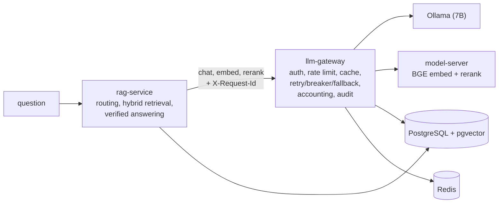

# grounded-finrag

Question answering over financial filings (10-K, 10-Q, 8-K, earnings releases) built the way an
enterprise would run it: every answer cites `[document, page]` and is verified against the
retrieved pages, numeric answers are computed in Python from cited line items, the system says
"insufficient evidence" instead of guessing, and **every model call goes through a Spring Boot
LLM gateway** with authentication, rate limiting, caching, circuit breaking, cost accounting and
an append-only audit log. Evaluated on a fixed dev/test split of the FinanceBench open-source
sample; every number below is generated from a committed results file that records the model,
hardware and commit.

**Non-commercial project.** Code: PolyForm Noncommercial 1.0.0 (`LICENSE`). Evaluation data:
FinanceBench, CC BY-NC 4.0 (`NOTICE.md`). No FinanceBench files are committed.

## Results

Models: `qwen2.5:7b-instruct-q4_K_M` (Ollama) for answers and judging, `bge-base-en-v1.5`
embeddings, `bge-reranker-base` cross-encoder (support score). Hardware: RTX 3060 Laptop GPU
(6 GB), i7-12700H. Tables below are written by `python -m finrag.eval.readme_tables`.

**Reading the results honestly.** On the test split the naive pipeline, which answers every
question, is right more often overall than the best configuration. The best configuration
retrieves the evidence page far more often, is right more often *when it answers*, and never
committed to an answer on the unanswerable probes, but it abstains on about half of the test
questions, and that coverage loss outweighs its precision gain. Extract-then-compute and model
arithmetic are within one question of each other on numeric questions in both splits. The judge
is strict (it never accepted an answer the human rejected), so all accuracies are lower bounds.

<!-- results:start -->

### Retrieval (evidence-page hit@k, 75 questions per split)

| Configuration | Split | hit@1 | hit@3 | hit@5 | hit@10 | MRR@10 | hit@5 95% CI | p50 ms |
|---|---|---|---|---|---|---|---|---|
| naive: fixed chunks, dense | dev | 0.12 | 0.2533 | 0.28 | 0.44 | 0.2122 | 0.1733-0.3867 | 54.05 |
| best: structure chunks, hybrid, routed | dev | 0.24 | 0.4533 | 0.6133 | 0.7067 | 0.3798 | 0.4933-0.72 | 54.26 |
| naive: fixed chunks, dense | test | 0.1333 | 0.32 | 0.3733 | 0.52 | 0.2429 | 0.2667-0.48 | 73.15 |
| best: structure chunks, hybrid, routed | test | 0.2 | 0.3733 | 0.5067 | 0.6667 | 0.3276 | 0.4-0.6133 | 73.14 |

Dev: commit `e599901`, NVIDIA GeForce RTX 3060 Laptop GPU, power plan Turbo, 2026-10-21. Test: commit `39c6675`, NVIDIA GeForce RTX 3060 Laptop GPU, power plan Turbo, 2026-10-21.
All 24 dev configurations: [results/retrieval/dev_ablation.md](results/retrieval/dev_ablation.md).

### Answers (test split, scored by the raw LLM judge verdict; the judge is strict, see agreement below)

| System | Accuracy | Precision when answering | Abstention rate | Citation precision (gold pages) | Accuracy 95% CI |
|---|---|---|---|---|---|
| naive RAG | 0.4 (30/75) | 0.4 | 0.0 | n/a (free text) | 0.2933-0.5067 |
| best (no threshold) | 0.2667 (20/75) | 0.5714 | 0.5333 | 0.3137 | 0.1733-0.3733 |
| best + abstention threshold 0.9873569011688232 | 0.08 (6/75) | 0.5455 | 0.8533 | 0.4375 | 0.0267-0.1467 |
| oracle (gold pages) | 0.4933 (37/75) | 0.6271 | 0.2133 | 1.0 | 0.3867-0.6 |

Numeric (metrics-generated) questions: extract-then-compute 0.28 (7/25) vs model arithmetic 0.24 (6/25).

commit `57a0a5d`, NVIDIA GeForce RTX 3060 Laptop GPU, power plan Turbo, 2026-10-22.

### Answers (dev split, scored by the raw LLM judge verdict; the judge is strict, see agreement below)

| System | Accuracy | Precision when answering | Abstention rate | Citation precision (gold pages) | Accuracy 95% CI |
|---|---|---|---|---|---|
| naive RAG | 0.2133 (16/75) | 0.2133 | 0.0 | n/a (free text) | 0.12-0.3067 |
| best (no threshold) | 0.2667 (20/75) | 0.4651 | 0.4267 | 0.4412 | 0.1733-0.3733 |
| best + abstention threshold 0.9873569011688232 | 0.1333 (10/75) | 0.7143 | 0.8133 | 0.4545 | 0.0667-0.2133 |
| oracle (gold pages) | 0.44 (33/75) | 0.5893 | 0.2533 | 1.0 | 0.3333-0.5467 |

Numeric (metrics-generated) questions: extract-then-compute 0.32 (8/25) vs model arithmetic 0.36 (9/25).

commit `8f38138`, NVIDIA GeForce RTX 3060 Laptop GPU, power plan Turbo, 2026-10-22.

### Other measurements

- **Judge vs human labels** (40 dev answers, one labeler): raw judge (used for scoring) 0.7 agreement, Cohen's kappa 0.4483; with the 1% tolerance override 0.675, kappa 0.4091. Disagreements: 12 answers the judge marked wrong that the human marked correct, 0 the other way, so judged accuracy is a lower bound.
- **Unanswerable probes** (30 questions about companies or periods not in the corpus): hallucination rate 0.0 for best, 0.0667 for naive.
- **Gateway, test split, best config** (75 questions): model time per question p50 8511.0 ms, p95 20948.9 ms; cost per question 0.0 USD (local models).
- **Tests:** rag-service 42 tests, 45.8% line coverage; llm-gateway 20 tests, 71.95% line coverage.

<!-- results:end -->

## How it works



1. **Ingestion** parses each PDF page by page, rebuilds financial tables as Markdown from word
   positions, tags chunks with company, form, fiscal period, page and section, and logs every
   parse repair ([docs/ingestion.md](docs/ingestion.md)).
2. **Retrieval** routes the question to the right company and period, fuses pgvector dense
   search and BM25 with Reciprocal Rank Fusion, and returns the top 5 chunks.
3. **Answering** asks the model for JSON claims citing source IDs (verified), or, for numeric
   questions, for cited line items plus a formula that Python evaluates. Failed checks get one
   repair, then the system abstains; a dev-tuned support threshold also triggers abstention.
4. **Evaluation**: page-level retrieval metrics for 24 configurations, an LLM judge validated
   against hand labels, citation precision, abstention curves, unanswerable probes, and naive vs
   best vs oracle comparisons. Test is scored once.

More: [architecture](docs/architecture.md) · [decision records](docs/adr/) ·
[judge rubric](docs/judge_rubric.md) · [AWS design (not deployed)](docs/aws-deployment.md) ·
[error analysis](docs/error-analysis.md)

## Quickstart

**With Docker only** (CPU embeddings; Ollama on the host with `OLLAMA_HOST=0.0.0.0`):

```bash
python scripts/download_financebench.py               # pinned commit, SHA-256 verified
ollama pull qwen2.5:7b-instruct-q4_K_M
docker compose --profile app up -d                    # PostgreSQL+pgvector, Redis, model-server, gateway, rag-service
docker compose run --rm rag-service python -m finrag.ingest.run
docker compose run --rm rag-service python -m finrag.retrieval.index
curl -s localhost:8000/answer -H "Content-Type: application/json" -d '{"question": "What was 3M capital expenditure in FY2018?"}'
```

**Natively** (how the numbers above were produced; GPU embeddings). Prerequisites: Docker,
Python 3.11, Java 21, Ollama, an NVIDIA GPU.

```bash
docker compose up -d                                  # PostgreSQL 17 + pgvector, Redis 7.2
python scripts/download_financebench.py
ollama pull qwen2.5:7b-instruct-q4_K_M
```

```bash
# model server (embeddings + re-ranker), reachable only by the gateway
cd model-server && pip install torch==2.11.0 --index-url https://download.pytorch.org/whl/cu128 \
  && pip install -r requirements.txt && uvicorn app:app --host 127.0.0.1 --port 8090
# gateway
cd llm-gateway && ./mvnw -q package -DskipTests && java -jar target/llm-gateway-0.0.1-SNAPSHOT.jar
# rag-service
cd rag-service && pip install -e ".[dev]"
python -m finrag.ingest.run && python -m finrag.retrieval.index
uvicorn finrag.api:app --port 8000                    # OpenAPI docs at http://127.0.0.1:8000/docs
```

Reproduce the evaluation: `python -m finrag.eval.retrieval_eval --split dev`, then
`python -m finrag.eval.answer_runs --split dev` and `python -m finrag.eval.answer_eval ...`
(see the module docstrings).

## Use it from Claude (MCP server)

`mcp_server/` exposes the pipeline as a [Model Context Protocol](https://modelcontextprotocol.io)
server built on the official Python SDK (`mcp==2.3.0`), so Claude Code or another MCP client can
search the filings and get cited answers. It wraps the evaluated pipeline without changing it: the
same retrieval configuration and the same dev-tuned abstention threshold. On the 20 benchmark
questions it made the same answer/abstain decision as the evaluated dev run on all 20
(`results/mcp/parity_dev.json`). Every model call goes through the
gateway as a separate client (`mcp-server`) with its own key, rate limit and audit-log entries.

| Tool | Arguments | Returns |
|---|---|---|
| `search_filings` | `query`, `company`?, `fiscal_year`?, `k` (1–10, default 5) | top evidence chunks, each with a `[document, page]` citation and score; `status: "no_evidence"` when nothing matches |
| `answer_question` | `question`, `company`? | a cited answer, or `abstained: true` with the reason; numeric answers include the computation |
| `list_filings` | none | the 84 indexed filings: company, form, fiscal year/quarter, chunk count |

All three are annotated `readOnlyHint: true`, `destructiveHint: false`. Failures come back as MCP
tool errors with a JSON body `{"error": {"code", "message", "retryable"}}`. The codes are
`unknown_company`, `no_matching_filings`, `timeout`, `rate_limited` (with the gateway's
Retry-After), `backend_unavailable`, `database_unavailable`, `gateway_unauthorized`,
`gateway_error`, `gateway_rejected` and `internal_error`. Details of an internal error go only to
the server log on stderr. Arguments that break the schema are rejected before the backend runs.
Deadlines are 45 s for a search, 300 s for an answer and 20 s for the filing list. Gateway HTTP
calls time out at 150 s, and database statements at 15 s.

**Tests.** There are 22 unit tests through a real in-process MCP client session with the backend
faked, covering success, abstention, invalid input, timeout, gateway and database errors, and the
parallel-call regression. CI runs them. Two end-to-end tests run against the real local stack
when `FINRAG_MCP_E2E=1`, one over stdio and one over streamable HTTP. CI has no model stack, so
it skips them.

**Setup.** The stack from the quickstart must be running.

```bash
pip install -e "rag-service[mcp]"
# The server gets its own gateway key. The gateway stores only the key's SHA-256 hash.
export GATEWAY_API_KEY="$(python -c 'import secrets; print(secrets.token_urlsafe(32))')"
export MCP_SERVER_KEY_SHA256="$(python -c 'import hashlib, os; print(hashlib.sha256(os.environ["GATEWAY_API_KEY"].encode()).hexdigest())')"
# Restart the gateway with MCP_SERVER_KEY_SHA256 in its environment, then from the repo root:
claude                                   # Claude Code reads .mcp.json and asks you to enable the server
```

[`.mcp.json`](.mcp.json) starts `python mcp_server/server.py` over stdio and passes
`${GATEWAY_API_KEY}` through from your shell, so the key is never written to a config file. Set
`FINRAG_PYTHON` if the interpreter with the `mcp` extra is not the `python` on your PATH.
`python mcp_server/server.py --transport streamable-http --port 8765` serves the same tools at
`http://127.0.0.1:8765/mcp`. That endpoint has no authentication of its own, so the server refuses
to bind it to anything except loopback.

**Demo transcripts** ([docs/demo/](docs/demo/)). Three real questions asked in Claude Code
2.1.218 with `claude-sonnet-5-5`, with only the three MCP tools available:
[3M capex](docs/demo/q1-3m-capex.md) answers $1,577 million [3M_2018_10K, p.60].
[AMD revenue](docs/demo/q2-amd-revenue.md) lists the AMD filings and answers $23,601 million
[AMD_2022_10K, p.68]. [Apple](docs/demo/q3-apple-not-indexed.md) is not indexed, so both tools
return `unknown_company` and the model reports that there is no evidence. Claude Code called tools
in parallel, which exposed a race that doubled the filing list. It was fixed before these runs, and
[the before-fix run](docs/demo/q3-before-fix.md) is kept.

**Latency per tool** (`results/mcp/latency.json`, commit `5345522`): 20 sequential calls per tool
from an MCP SDK client over stdio, measured client side from `call_tool` sent to result received.
The 20 questions are distinct dev-split questions. Setup: gateway cache off, model server on CPU,
Ollama `qwen2.5:7b-instruct-q4_K_M` on the RTX 3060 Laptop GPU, Turbo power plan, one warm-up call
per tool excluded.

| Tool | n | p50 | p95 | errors |
|---|---|---|---|---|
| `list_filings` (served from the server's cache after the first call) | 20 | 16.3 ms | 25.1 ms | 0 |
| `search_filings` (embed, hybrid retrieve, re-rank) | 20 | 133.9 ms | 163.4 ms | 0 |
| `answer_question` (18 of 20 abstained; every call still ran the LLM) | 20 | 6307.7 ms | 11876.8 ms | 0 |

The excluded first calls took 10384.5 ms (`list_filings`, which waits for the BM25 index to build at
startup), 194.8 ms (`search_filings`) and 6524.5 ms (`answer_question`). Reproduce with
`GATEWAY_API_KEY=... python mcp_server/bench_latency.py`.

**Security.**
- *Read-only.* No tool writes to the database, the index or the gateway, and none takes a file
  path, URL or SQL. The only writes are the gateway's bookkeeping for the server's own calls:
  audit-log rows, rate-limit counters and, when the cache is on, response-cache entries.
- *Secrets from the environment.* `GATEWAY_API_KEY` is read once from the environment. It is never
  logged, returned or written to a config file, and the gateway compares only its hash.
- *Filing text is untrusted.* Every result carries a `notice` that its text fields are untrusted
  data. The server instructions tell the client never to follow instructions inside them. The
  server strips control characters and truncates each chunk to 2,000 characters, but it cannot stop
  a client model from obeying text it reads. That defense belongs in the client, and it was not
  red-teamed here.

**Limitations.** One local machine, with laptop latencies. Claude Code (CLI, `-p` mode) is the only
chat client that was tested. Claude Desktop, ChatGPT and other clients are **untested**. The
streamable-HTTP transport was tested end to end only with the MCP Python SDK client, so with real
chat clients it is **untested**. `answer_question` inherits the best configuration's high
abstention rate. The client model's own prose is not checked: in the Apple transcript it added an
unverified figure from its own knowledge and said so. There is no deployment, no multi-user
authentication on the MCP side, and no usage beyond these tests.

## Repository map

| Path | What |
|---|---|
| `rag-service/src/finrag/ingest/` | PDF parsing, table recovery, text repair, chunking, evidence-page check |
| `rag-service/src/finrag/retrieval/` | pgvector store, BM25, RRF, metadata routing, pipeline |
| `rag-service/src/finrag/answer/` | prompts, citation verification, extract-then-compute |
| `rag-service/src/finrag/eval/` | metrics, ablation, judge, human labels, abstention tuning, reports |
| `llm-gateway/` | Spring Boot gateway: providers, resilience, rate limit, cache, accounting, audit |
| `model-server/` | FastAPI host for the BGE embedder and cross-encoder |
| `mcp_server/` | MCP server: three read-only tools over the pipeline, its tests and latency benchmark |
| `docs/demo/` | Claude Code transcripts of the MCP tools in use |
| `results/` | every committed number, with provenance |
| `data/splits/`, `data/probes/`, `data/labels/` | dev/test IDs, unanswerable probes, hand labels (IDs only) |

## Limitations

- **The best configuration abstains too often.** Its overall test accuracy is below the naive
  pipeline's; the abstention behavior (model flag and support threshold, both chosen on dev) trades
  too much coverage for precision. Re-tuning it is future work and would need a fresh test set.
- **Small evaluation sets.** 75 test questions: a single question moves accuracy by 1.33
  points, and the 95% intervals in the tables are wide. Dev and test share 18 documents.
- **One local 7B model.** Answers and the judge both use `qwen2.5:7b-instruct` (validated against
  40 hand labels, but a single labeler). Partial CPU offload on the 6 GB GPU made temperature-0
  output not perfectly repeatable, and latencies are laptop latencies.
- **Retrieval selection was revised on dev** after the ablation (hybrid instead of the
  rule's dense pick, on hit@5); recorded in `results/retrieval/selected.json`.
- **Parsing heuristics.** Geometry-based tables miss some layouts (two-column releases,
  title lines absorbed into headers, rotated text).
- **Routing** uses an alias list for the 32 corpus companies; unknown companies fall back to
  unfiltered search, and a few FinanceBench questions name no company at all.
- **The AWS deployment is a design**, not something that was run.
- **Not investment advice**; non-commercial use only.
