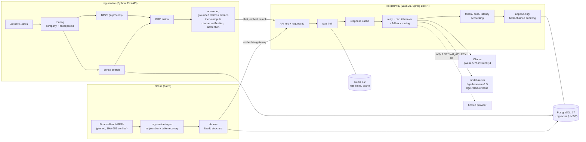

# Architecture

## Components

| Component | Tech | Responsibility |
|---|---|---|
| `rag-service/` | Python 3.11, FastAPI | Ingestion (PDF parsing, table recovery, chunking), retrieval (pgvector, BM25, RRF, routing), answering (citations, abstention, extract-then-compute), evaluation |
| `llm-gateway/` | Java 21, Spring Boot 4.1, Resilience4j | The only path to any model: auth, rate limiting, caching, retries, circuit breaking, fallback, accounting, redaction, audit |
| `model-server/` | FastAPI, sentence-transformers, PyTorch | Hosts the BGE embedding model and the cross-encoder; reachable only from the gateway |
| PostgreSQL + pgvector | Docker (pinned digest) | Chunk embeddings (one table per chunking strategy), gateway audit log (`gateway` schema) |
| Redis | Docker (pinned digest) | Per-client rate-limit counters, response cache |
| Ollama | Local, Windows | 7B instruct model on the RTX 3060 (6 GB) |

## Request flow (one question)

1. `rag-service` assigns an `X-Request-Id`. Every gateway call for the question carries it,
   and the gateway logs it via MDC and writes it into the audit row.
2. Routing infers company and fiscal period and limits the search to matching filings.
3. Dense (query embedding through the gateway, pgvector HNSW) and BM25 rankings are fused
   with RRF; the top 5 chunks become sources `[S1]`..`[S5]`.
4. The model answers in JSON. Grounded claims must cite source IDs that were actually
   provided. Numeric questions use extract-then-compute: cited line items, then a formula
   evaluated in Python. A failed check gets one repair round, then the system abstains.
5. A support score (best cross-encoder relevance of the sources) below a threshold tuned on
   dev also leads to "insufficient evidence".

## Why each model call goes through the gateway

See [ADR 001](adr/001-gateway-is-the-only-path-to-models.md). In short: one place to
authenticate, rate-limit, cache, account for and audit every call; swapping a local model
for a hosted one (for example Bedrock) is a gateway configuration change, not an application
change.
