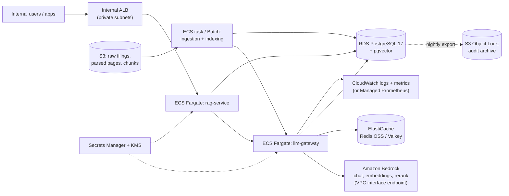

# AWS deployment design

> **Design only: not deployed.** Nothing here has been provisioned or measured on AWS. It maps
> each local component to the AWS service that would replace it, and states what would change.

| Local component | AWS service | Notes |
|---|---|---|
| `data/raw` PDFs, `data/processed` | S3 (SSE-KMS, versioned) | New filings land in a prefix; an S3 event (EventBridge) starts ingestion |
| Ingestion / indexing scripts | ECS Fargate task or AWS Batch | Same container image as the rag-service; embeddings go through the gateway like today |
| PostgreSQL + pgvector (Docker) | RDS for PostgreSQL 17 with the `vector` extension, Multi-AZ | One instance for chunks (public schema) and the audit log (gateway schema). The gateway's DB role gets INSERT/SELECT only on the audit table; triggers stay as defense in depth |
| Redis (Docker) | ElastiCache (Redis OSS or Valkey), TLS + AUTH | The Lua rate-limit script and cache keys work unchanged on a single shard |
| `llm-gateway` | ECS Fargate service, 2+ tasks across AZs | Stateless (state is in Redis/RDS), so it scales horizontally; health checks on `/actuator/health/liveness` |
| `rag-service` | ECS Fargate service behind an internal ALB | BM25 index is built in memory at start from the chunk table |
| Ollama (qwen2.5 7B) | Amazon Bedrock (a chat model chosen by evaluation) | A `BedrockProvider` adapter next to the Ollama/OpenAI ones; the alias `local-chat` would point at it. Re-run the dev evaluation before switching |
| `model-server` embeddings | Bedrock embedding model, or a SageMaker endpoint hosting bge-base-en-v1.5 | Switching embedding model means re-embedding the corpus and re-running the retrieval ablation |
| `model-server` re-ranker | Bedrock rerank model or SageMaker | Only used for the abstention support score in the current design; the threshold must be re-tuned on dev |
| API-key hashes, DB/Redis credentials, provider keys | Secrets Manager (KMS) | Injected as ECS secrets; rotation without redeploy |
| Logs and metrics | CloudWatch Logs; Micrometer -> CloudWatch or Amazon Managed Prometheus | Redaction happens in the app before logs leave the container |
| Audit log | RDS table + nightly export to S3 with Object Lock (compliance mode) | Object Lock makes the archived history immutable even to administrators |

## Network and security

- Everything in private subnets; no internet egress. VPC interface endpoints for Bedrock,
  Secrets Manager, CloudWatch and ECR; a gateway endpoint for S3.
- Only the gateway's task role may call Bedrock (`bedrock:InvokeModel` on specific model ARNs),
  which keeps "the gateway is the only path to any model" true at the IAM level, not just in code.
- Security groups: ALB -> rag-service -> gateway -> (RDS, ElastiCache, endpoints). The model
  tier is unreachable from the rag-service directly.
- TLS everywhere (ALB, ElastiCache in-transit encryption, RDS `sslmode=verify-full`).
- Container images scanned in ECR; the same CodeQL, OSV and pip-audit gates run in CI before
  deployment.

## What would need to change in the code

1. A `BedrockProvider` adapter (AWS SDK v2, SigV4 via the task role) for chat, embeddings and
   rerank, behind the same `ModelProvider` interface.
2. Datasource and Redis settings from environment variables, as today, with TLS options.
3. Cost accounting with real per-1k-token prices per Bedrock model in the alias config
   (local models are configured at 0 today).
4. Re-run ingestion, indexing, the retrieval ablation and the answer evaluation on the new
   models before trusting any number: no local result transfers automatically.
